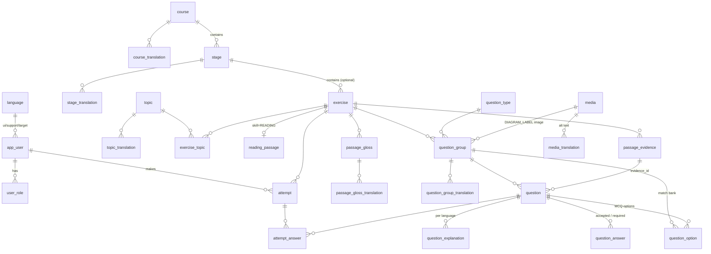

# Design — Database

## 1. Decisions at a glance

| Topic | Decision | Why |
|-------|----------|-----|
| Engine | **PostgreSQL 16** everywhere (Docker locally, Testcontainers in tests) | `jsonb`, partial indexes, check constraints, real collations. H2 hides dialect bugs. |
| Migrations | **Flyway**, `src/main/resources/db/migration/V{n}__*.sql`; Hibernate `ddl-auto=validate` | The schema is reviewed SQL, not generated by entities. |
| Keys | `bigint generated always as identity` internally; **slug** / **UUID** publicly. Exception (V5): `exercise`, `question_group`, `question` are `generated by default`, so the application can assign ids taken from the same sequences | Small, fast joins; URLs are stable and don't leak row counts. A question keeps its id across edits, so attempts never point at the wrong question. |
| i18n | **One `*_translation` table per translatable entity**, keyed `(owner_id, language_code)` | Typed columns and real foreign keys. A generic EAV "strings" table loses both. |
| Content vs help text | Exam content goes on the main row (target language). Help text goes in `*_translation` (support languages). | This one rule decides where every column goes (§3). |
| Glosses | Moved **out of the HTML**: `data-az="…"` becomes `data-g="g7"`, and meanings go in `passage_gloss_translation` | Adding Russian or Turkish must not mean editing the passage HTML. |
| Question numbers | **Derived** from (group.position, question.position) and points ("Choose TWO" = Q7–8) | Reordering can't create gaps or duplicates. |
| IELTS rules | Word limit, reusable options, "Choose TWO" = 2 points stored on `question_group`; scores are **points** | Grading follows the real exam (§4.6). |
| Files | Images/audio in file storage; the `media` table holds metadata only | Keeps the database small and backups fast. |
| Timer | `duration_seconds` is optional | Grammar drills may have no timer. |
| Discovery | Exercises are **standalone and never locked**. Learners browse and filter (skill, format, level, question type, duration, topic, not done yet). Course/stage is an **optional** grouping. | Admins publish a mini reading on its own; learners pick what they want. |
| History | Attempts store their own graded snapshot plus `exercise.revision` | Editing a published exercise never rewrites a learner's past results. |
| Deletes | Exercises with attempts are archived; FKs `ON DELETE RESTRICT` from attempts | No orphaned history. |

---

## 2. Entity overview



---

## 3. The language rule

Every piece of text is one of two kinds:

| Kind | Language | Lives in | Examples |
|------|----------|----------|----------|
| **Exam content** | `exercise.target_language` (`en`) | the main row | passage HTML, exercise title, question stems, option labels, accepted answers, official IELTS instruction |
| **Help text** | any support language | `*_translation` rows | gloss meanings, explanations, translated instructions, course and stage titles |

When the API is asked for language `L` (from the user profile, `?lang=`, or
`Accept-Language`), each piece of help text is looked up item by item:
**`L` → `en` → hidden**. The fallback comes from `language.fallback_code`, so
a regional variant such as `pt-BR` can fall back to `pt` first, then `en`.

UI labels such as "Submit" and "Start again" are **not** content. They live
in `messages_{lang}.properties` / JSON bundles in the repository.

---

## 4. Schema (PostgreSQL)

### 4.1 Reference data

```sql
create table language (
    code          varchar(16) primary key,          -- BCP-47: 'en', 'az', 'ru', 'pt-BR'
    name_en       text        not null,             -- 'Azerbaijani'
    name_native   text        not null,             -- 'Azərbaycanca'
    direction     varchar(3)  not null default 'ltr' check (direction in ('ltr','rtl')),
    fallback_code varchar(16) references language(code),
    is_target     boolean     not null default false,  -- can be learned/tested
    is_support    boolean     not null default true,   -- can be a learner's help language
    enabled       boolean     not null default false,  -- visible in pickers
    sort_order    int         not null default 0
);

create table question_type (                       -- mirrors admin/questionTypes.js
    code    varchar(32) primary key,               -- 'TFNG','FILL','MCQ','MATCH_HEADINGS',...
    family  varchar(16) not null check (family in ('choiceFixed','gap','mcSingle','mcMulti','match')),
    enabled boolean     not null default true
);
```

The labels of question types are UI strings, so they go in bundles, not here.

### 4.2 Users and roles

```sql
create table app_user (
    id               bigint generated always as identity primary key,
    public_id        uuid        not null unique default gen_random_uuid(),
    email            text        unique check (email = lower(email)),  -- stored lower-cased
    display_name     text,
    ui_language      varchar(16) not null references language(code),
    support_language varchar(16) not null references language(code),
    target_language  varchar(16) not null default 'en' references language(code),
    status           varchar(16) not null default 'ACTIVE' check (status in ('ACTIVE','DISABLED','DELETED')),
    created_at       timestamptz not null default now(),
    updated_at       timestamptz not null default now()
);

create table user_role (
    user_id bigint      not null references app_user(id) on delete cascade,
    role    varchar(16) not null check (role in ('LEARNER','AUTHOR','TRANSLATOR','ADMIN')),
    primary key (user_id, role)
);
```

**Login tables (V3, for email/password sign-in with JWT):**

```sql
create table user_credential (
    user_id       bigint      primary key references app_user(id) on delete cascade,
    password_hash text        not null,                    -- BCrypt hash only
    updated_at    timestamptz not null default now()
);

create table refresh_token (                               -- one row per issued refresh token
    id          bigint generated always as identity primary key,
    user_id     bigint      not null references app_user(id) on delete cascade,
    token_hash  varchar(64) not null unique,               -- SHA-256 hex of the cookie value
    family_id   uuid        not null,                      -- one login session
    issued_at   timestamptz not null default now(),
    expires_at  timestamptz not null,
    replaced_by bigint      references refresh_token(id) on delete set null,  -- set on rotation
    revoked_at  timestamptz,
    check (expires_at > issued_at),
    check (token_hash ~ '^[0-9a-f]{64}$')
);
```

Credentials are kept out of `app_user`, so another sign-in method (e.g.
Google) can be added later as its own table.

### 4.3 Curriculum

```sql
create table course (
    id              bigint generated always as identity primary key,
    slug            varchar(80) not null unique,
    skill           varchar(16) not null check (skill in ('READING','LISTENING','WRITING','SPEAKING','GRAMMAR')),
    target_language varchar(16) not null references language(code),
    position        int         not null,
    status          varchar(16) not null default 'DRAFT' check (status in ('DRAFT','PUBLISHED','ARCHIVED'))
);
create table course_translation (
    course_id     bigint      not null references course(id) on delete cascade,
    language_code varchar(16) not null references language(code),
    title         text        not null,
    description   text,
    primary key (course_id, language_code)
);

create table stage (
    id        bigint generated always as identity primary key,
    course_id bigint not null references course(id),
    position  int    not null,
    unique (course_id, position)
);
create table stage_translation (
    stage_id      bigint      not null references stage(id) on delete cascade,
    language_code varchar(16) not null references language(code),
    title         text        not null,                -- 'Stage 1' / 'Mərhələ 1'
    primary key (stage_id, language_code)
);
```

The current `stageLabel` "Stage 1 · Mini passage 4" is **derived**:
`stage_translation.title` + a UI-bundle pattern ("Mini passage {n}") using
`exercise.position`.

### 4.4 Exercise (all skills)

```sql
create table exercise (
    id                         bigint generated always as identity primary key,
    slug                       varchar(120) not null unique,          -- public id: /reading/{slug}
    skill                      varchar(16)  not null check (skill in ('READING','LISTENING','WRITING','SPEAKING','GRAMMAR')),
    target_language            varchar(16)  not null references language(code),
    stage_id                   bigint       references stage(id),
    position                   int,                                   -- order within stage
    title                      text         not null,                 -- target language
    format                     varchar(8)   not null default 'MINI' check (format in ('MINI','FULL')),  -- filter: mini test vs full IELTS-size
    level                      varchar(2)   check (level in ('A1','A2','B1','B2','C1','C2')),          -- filter: CEFR difficulty; null = not set
    duration_seconds           int,                                   -- null = no timer (e.g. grammar drills)
    low_time_threshold_seconds int,                                   -- null = no low-time warning
    status                     varchar(16)  not null default 'DRAFT' check (status in ('DRAFT','PUBLISHED','ARCHIVED')),
    revision                   int          not null default 1,       -- bumped on every save of content
    version                    bigint       not null default 0,       -- edit version, checked under a row lock (optimistic)
    published_at               timestamptz,
    created_at                 timestamptz  not null default now(),
    updated_at                 timestamptz  not null default now(),
    created_by                 bigint       references app_user(id),
    updated_by                 bigint       references app_user(id),
    check (duration_seconds is null or duration_seconds > 0),
    check (low_time_threshold_seconds is null or
           (duration_seconds is not null and low_time_threshold_seconds > 0
            and low_time_threshold_seconds <= duration_seconds)),
    check ((stage_id is null) = (position is null)),   -- in a stage => has a position
    unique (stage_id, position)
);
create index exercise_published_idx on exercise (stage_id, position) where status = 'PUBLISHED';
create index exercise_browse_idx    on exercise (skill, format, level) where status = 'PUBLISHED';
```

### 4.4.1 Topics (for filtering)

```sql
create table topic (
    id       bigint generated always as identity primary key,
    slug     varchar(60) not null unique,        -- 'nature', 'science', 'history' (used in filter URLs)
    position int         not null default 0      -- order in the filter list
);
create table topic_translation (
    topic_id      bigint      not null references topic(id) on delete cascade,
    language_code varchar(16) not null references language(code),
    name          text        not null,          -- 'Nature' / 'Təbiət' / 'Doğa'
    primary key (topic_id, language_code)
);
create table exercise_topic (                    -- an exercise can have several topics
    exercise_id bigint not null references exercise(id) on delete cascade,
    topic_id    bigint not null references topic(id)    on delete cascade,
    primary key (exercise_id, topic_id)
);
create index exercise_topic_topic_idx on exercise_topic (topic_id);
```

### 4.4.2 Media (images now, audio for Listening later)

```sql
create table media (
    id          bigint generated always as identity primary key,
    public_id   uuid        not null unique default gen_random_uuid(),   -- used in URLs
    kind        varchar(8)  not null check (kind in ('IMAGE','AUDIO')),
    storage_key text        not null unique,     -- path in file storage (disk / S3). The file itself is NOT in the DB.
    mime_type   varchar(64) not null,            -- 'image/png', 'audio/mpeg'
    byte_size   bigint      not null check (byte_size > 0),
    width       int,                             -- IMAGE only
    height      int,                             -- IMAGE only
    duration_ms int,                             -- AUDIO only
    created_at  timestamptz not null default now(),
    created_by  bigint      references app_user(id)
);
create table media_translation (
    media_id      bigint      not null references media(id) on delete cascade,
    language_code varchar(16) not null references language(code),
    alt_text      text        not null,          -- description for screen readers, per language
    primary key (media_id, language_code)
);
```

Files are stored in file storage, not in the database. The database keeps only
metadata and the `storage_key`. One `media` row can be reused by many groups.

### 4.5 Reading passage, glosses, evidence

```sql
create table reading_passage (
    exercise_id bigint primary key references exercise(id) on delete cascade,
    body_html   text   not null,       -- sanitized; contains <span class="w" data-g="gN"> and <span class="ev" id="eN">
    word_count  int    not null default 0
);

create table passage_gloss (
    id          bigint generated always as identity primary key,
    exercise_id bigint      not null references exercise(id) on delete cascade,
    gloss_key   varchar(16) not null,          -- 'g7', referenced by data-g in body_html
    surface     text        not null,          -- 'eliminated' (as it appears)
    lemma       text,                          -- 'eliminate' (optional; for future vocab features)
    unique (exercise_id, gloss_key)
);
create table passage_gloss_translation (
    gloss_id      bigint      not null references passage_gloss(id) on delete cascade,
    language_code varchar(16) not null references language(code),
    meaning       text        not null,        -- 'məhv edilmək'; 'en' row = simple English definition
    source        varchar(8)  not null default 'HUMAN' check (source in ('HUMAN','MACHINE')),
    reviewed      boolean     not null default false,
    updated_at    timestamptz not null default now(),
    primary key (gloss_id, language_code)
);

create table passage_evidence (
    id           bigint generated always as identity primary key,
    exercise_id  bigint      not null references exercise(id) on delete cascade,
    evidence_key varchar(16) not null,         -- 'e4', the id="" in body_html
    unique (exercise_id, evidence_key),
    unique (exercise_id, id)                   -- target for the composite FK in question
);
```

**The HTML stays the source of truth for positions.** On every admin save the
server sanitizes `body_html`, collects all `data-g` and `ev` ids, and **syncs**
`passage_gloss` and `passage_evidence` in the same transaction: new keys are
inserted, keys that disappeared are deleted. A deleted evidence span that a
question still references fails the save with a 422 (FK `RESTRICT`), which is
the "block delete" answer to admin design open question 2.

### 4.6 Questions, options, answers, explanations

```sql
create table question_group (
    id              bigint generated always as identity primary key,
    exercise_id     bigint      not null references exercise(id) on delete cascade,
    position        int         not null,
    type_code       varchar(32) not null references question_type(code),
    instruction_html text       not null,      -- official instruction, target language
    choose_count     int        check (choose_count > 0),   -- mcMulti: "Choose TWO" -> 2 (also = points per question)
    max_words        int        check (max_words > 0),      -- gap: "NO MORE THAN TWO WORDS" -> 2; null = no limit
    numbers_allowed  boolean    not null default false,     -- gap: "... AND/OR A NUMBER"
    options_reusable boolean    not null default false,     -- match: "You may use any letter more than once"
    media_id         bigint     references media(id),       -- DIAGRAM_LABEL: the picture with numbered blanks
    unique (exercise_id, position),
    unique (exercise_id, id)                                -- target for question's same-exercise FK
);
create table question_group_translation (
    group_id         bigint      not null references question_group(id) on delete cascade,
    language_code    varchar(16) not null references language(code),
    instruction_html text        not null,     -- helper translation shown beside the official one
    primary key (group_id, language_code)
);

create table question (
    id          bigint generated always as identity primary key,
    exercise_id bigint not null references exercise(id) on delete cascade,  -- denormalized for FKs/indexes
    group_id    bigint not null,
    position    int    not null,               -- within group
    stem_text   text,                          -- statement / question / prompt
    stem_pre    text,                          -- gap: text before the blank
    stem_post   text,                          -- gap: text after the blank
    evidence_id bigint,
    unique (group_id, position),
    foreign key (exercise_id, group_id) references question_group (exercise_id, id) on delete cascade,  -- group from the SAME exercise
    foreign key (exercise_id, evidence_id) references passage_evidence (exercise_id, id),   -- NO ACTION: checked at end of statement, so exercise cascade-delete works
    check (stem_text is not null or stem_pre is not null)
);
create index question_evidence_idx on question (exercise_id, evidence_id) where evidence_id is not null;

create table question_option (
    id          bigint generated always as identity primary key,
    group_id    bigint references question_group(id) on delete cascade,   -- match family: shared bank
    question_id bigint references question(id)       on delete cascade,   -- mcSingle/mcMulti: own options
    option_key  varchar(8) not null,           -- 'A', 'B', 'i', 'ii'
    label       text       not null,           -- target language
    position    int        not null,
    check ((group_id is null) <> (question_id is null)),
    unique (group_id, option_key),
    unique (question_id, option_key)
);

create table question_answer (
    id          bigint generated always as identity primary key,
    question_id bigint not null references question(id) on delete cascade,
    value       text   not null,               -- 'FALSE' | 'riverbanks' | 'B'
    position    int    not null,
    unique (question_id, value)
);

create table question_explanation (
    question_id      bigint      not null references question(id) on delete cascade,
    language_code    varchar(16) not null references language(code),
    explanation_html text        not null,
    source           varchar(8)  not null default 'HUMAN' check (source in ('HUMAN','MACHINE')),
    reviewed         boolean     not null default false,
    updated_at       timestamptz not null default now(),
    primary key (question_id, language_code)
);
```

**What the answer rows mean depends on the family**:

| Family | Types | `question_answer` rows | Points |
|--------|-------|------------------------|--------|
| choiceFixed | TFNG, YNNG | exactly 1 (`TRUE`/`FALSE`/`NOT GIVEN`) | 1 if given = value |
| gap | FILL, SUMMARY, SHORT, DIAGRAM_LABEL | 1..n **accepted alternatives** | 1 if normalized given ∈ values **and** within the word limit |
| mcSingle | MCQ | exactly 1 option key | 1 if given = key |
| mcMulti | MCMA | k **required** option keys (k = `choose_count`) | **1 per correct key**, max k; more than k keys given → 0 |
| match | MATCH_HEADINGS / INFO / FEATURES / ENDINGS, SUMMARY_BOX | exactly 1 option key from the group bank | 1 if given = key |

**IELTS rules stored on `question_group`:**

- **Word limit** (`max_words`, `numbers_allowed`): count the words in the given
  answer. With `numbers_allowed`, numbers ("17", "1995") don't count towards
  the limit. Example with `max_words = 2, numbers_allowed = true`:
  "17 grey wolves" passes (2 words + a number), "the grey wolves" fails
  (3 words). Publish validation also checks that every accepted answer fits
  the limit.
- **Reusable options** (`options_reusable`): `false` for headings (each used at
  most once, so the UI greys out a used heading and publish validation rejects
  two questions with the same answer), `true` for matching information or
  features.
- **Summary from a box** is its own type, `SUMMARY_BOX`, in the *match* family:
  the box is the group option bank and each gap's answer is one option key. Its
  stem uses `stem_pre`/`stem_post` like FILL.
- **Diagram labels** (`DIAGRAM_LABEL`, gap family) need `media_id` (checked on
  publish). The numbers are drawn on the image, and each question is one label.

**Points and numbering.** A question is worth `choose_count` points for
mcMulti and 1 point otherwise. It takes that many question numbers. For
example, a "Choose TWO" question after Q6 is shown as **Q7–8**, and the next
question is Q9. The exercise total is the sum of points, and a full IELTS test
adds up to 40.

Answer and explanation tables sit beside the content they belong to. Learners
can't see them because the learner read query projects only
`exercise / reading_passage / question_group / question / question_option /
passage_gloss*`. Answers only appear in the grading service and the admin DTOs.

### 4.7 Attempts

```sql
create table attempt (
    id                uuid        primary key default gen_random_uuid(),
    user_id           bigint      references app_user(id),            -- null = anonymous
    exercise_id       bigint      not null references exercise(id) on delete restrict,
    exercise_revision int         not null,
    support_language  varchar(16) not null references language(code), -- language feedback was shown in
    started_at        timestamptz,
    submitted_at      timestamptz not null default now(),
    elapsed_seconds   int         not null check (elapsed_seconds >= 0),
    score             int         not null check (score >= 0),   -- sum of points_awarded
    total             int         not null check (total >= 0),   -- sum of points_possible
    check (score <= total)
);
create index attempt_user_idx     on attempt (user_id, submitted_at desc) where user_id is not null;
create index attempt_exercise_idx on attempt (exercise_id, submitted_at desc);
create index question_group_type_idx on question_group (type_code, exercise_id);  -- filter by question type

create table attempt_answer (
    attempt_id      uuid   not null references attempt(id) on delete cascade,
    question_id     bigint not null references question(id) on delete restrict,
    question_number int    not null,           -- first n as shown at the time (7 for "Q7–8")
    given_value     jsonb  not null,           -- "FALSE" | "riverbanks" | ["A","C"]
    expected_value  jsonb  not null,           -- snapshot of question_answer values at grading time
    points_awarded  int    not null check (points_awarded >= 0),
    points_possible int    not null check (points_possible > 0),
    is_correct      boolean generated always as (points_awarded = points_possible) stored,
    check (points_awarded <= points_possible),
    primary key (attempt_id, question_id)
);
create index attempt_answer_question_idx on attempt_answer (question_id);
```

The real migration (`db/migration/V1__core_schema.sql`) gives the important
constraints explicit names (for example `question_evidence_same_exercise_fk`,
`exercise_low_time_check`, `attempt_exercise_fk`). The server maps these names
to clear 422 messages, such as "evidence e1 is still used by a question".

`percent` is computed, not stored. `attempt` is the fastest-growing table, so
once volume calls for it, partition it by `submitted_at` (monthly). The
schema already permits this.

> `question.on delete restrict` from `attempt_answer` means that once an
> exercise has attempts, its questions can't be deleted outright. The admin
> editor then has to **archive the exercise and duplicate it** for a
> structural rewrite. Text edits (stems, explanations, translations) are
> always allowed.

---

## 5. Mapping to the existing API contracts

### 5.0 Learner `GET /api/v1/exercises` — browse and filter

Exercises are standalone: nothing is locked, and course/stage is optional. Every
filter is optional and they combine with AND:

```
GET /api/v1/exercises?skill=READING&format=MINI&level=B1&type=TFNG
                     &topic=nature&maxMinutes=10&notDone=true&lang=az&page=0&size=20
```

| Parameter | Uses | Notes |
|-----------|------|-------|
| `skill` | `exercise.skill` | |
| `format` | `exercise.format` | `MINI` / `FULL` |
| `level` | `exercise.level` | repeatable: `level=B1&level=B2` |
| `type` | exists `question_group.type_code` | "has at least one group of this type" |
| `topic` | `exercise_topic` → `topic.slug` | repeatable |
| `maxMinutes` | `exercise.duration_seconds` | exercises without a timer always match |
| `notDone` | no `attempt` by this user | logged-in users only, ignored for anonymous |

```json
{ "items": [ { "id": "yellowstone-wolves", "title": "The Return of the Wolves", "skill": "READING",
               "format": "MINI", "level": "B1", "durationSeconds": 300, "questionCount": 8,
               "types": ["TFNG","FILL","MCMA"], "topics": [ { "slug": "nature", "name": "Təbiət" } ],
               "bestScore": { "score": 5, "total": 8 } } ],
  "page": 0, "size": 20, "totalItems": 37 }
```

Only PUBLISHED exercises are listed. `topics[].name` is resolved in `lang`
with fallback. `bestScore` is present only for logged-in users who have
attempted it. The response never includes answers.

### 5.1 Learner `GET /api/v1/passages/{slug}?lang=az`

Only PUBLISHED exercises are served. The response keeps its shape, with a few
additions (glosses map, direction, the IELTS rules, and number ranges):

```json
{
  "id": "yellowstone-wolves",
  "language": "az",
  "direction": "ltr",
  "stageLabel": "Mərhələ 1 · Mini passage 4",
  "passageHtml": "<span class=\"ev\" id=\"e1\">… <span class=\"w\" data-g=\"g1\">eliminated</span> …</span>",
  "glosses": { "g1": "məhv edilmək", "g2": "dövlət tərəfindən dəstəklənən" },
  "questionGroups": [
    { "type": "TFNG", "heading": "Questions 1–3", "instruction": "…",
      "instructionTranslated": "…", "questions": [ { "n": 1, … } ] },
    { "type": "FILL", "maxWords": 1, "numbersAllowed": false, … },
    { "type": "MCMA", "chooseCount": 2, "heading": "Questions 7–8",
      "questions": [ { "n": 7, "nTo": 8, "text": "Which TWO …", "options": [ … ] } ] },
    { "type": "MATCH_HEADINGS", "optionsReusable": false, "options": [ … ], … },
    { "type": "DIAGRAM_LABEL", "media": { "url": "/media/3f2a…", "alt": "…" }, … }
  ]
}
```

- `glosses` is resolved with the fallback chain. Any key that is missing in
  every language in the chain is left out, and the word is shown unmarked.
- `heading` ("Questions 1–3"), `n` and `nTo` are derived from positions and points.
- **Client change**: `reading/app.js` looks meanings up as
  `glosses[el.dataset.g]` instead of `el.dataset.az`. **Sanitizer allow-list**:
  `data-az` is replaced by `data-g`.

### 5.2 `POST /api/v1/attempts`

The request is unchanged. The server maps `n` to a `question.id` using the
derived order, grades by family and points (§4.6, including the word limit), and writes `attempt` and
`attempt_answer` in one transaction. The `explanation` in each result is
resolved in the attempt's `support_language` with fallback.

### 5.3 Admin `/api/v1/admin/passages/**`

The admin object gains per-language maps; the rest keeps its shape:

```json
"glosses":      { "g1": { "surface": "eliminated", "meanings": { "az": "məhv edilmək", "en": "removed completely" } } },
"answerKey":    [ { "n": 1, "answer": "FALSE", "evidenceId": "e1",
                    "explanations": { "en": "<b>Mainly</b> = …", "az": "…" } } ]
```

`PUT` replaces the content tree (groups and questions matched by **id**,
glosses and evidence by key; options and answers replaced) and syncs glosses
and evidence from the HTML (backend design §8.3–8.4). It must
send `version`, and a stale version gets `409 Conflict`. A save of a
PUBLISHED exercise bumps `revision`.

A follow-up endpoint for translators, `PUT /api/v1/admin/passages/{slug}/translations/{lang}`,
writes only `*_translation` rows. That is what the TRANSLATOR role is limited to.

---

## 6. JPA mapping notes

- One entity per table. Translations are `@OneToMany` maps
  (`@MapKeyColumn(name="language_code")`) or separate entities with an
  `@EmbeddedId`.
- `exercise.version` is checked and raised by the backend under a row lock
  (`SELECT … FOR UPDATE`) on every save, instead of JPA `@Version` (backend
  design §8.3). Children are saved by the Exercise adapter in an explicit
  order (unique keys aren't deferrable). Attempts are a **separate
  aggregate**.
- Ids of `exercise`, `question_group` and `question` are assigned by the
  application before insert (`nextval` of the table's own sequence, V5);
  children are matched by id on save, never by position.
- Use enums with `@Enumerated(STRING)` for `skill`, `status`, `family`,
  `role` and `source`, so they match the check constraints.
- Learner reads use **DTO projections / dedicated queries**, never the full
  aggregate, so answers can't be serialized to learners by accident.

---

## 7. Seed data (V2 migration)

- `language`: `en` (target and support, enabled), `az` (support, enabled,
  fallback `en`), and a few more (`ru`, `tr`, `uz`, `kk`, `ar` with `rtl`)
  present but `enabled = false`.
- `question_type`: 13 codes, the 11 from `questionTypes.js` plus `SUMMARY_BOX`
  (match) and `DIAGRAM_LABEL` (gap), with their families.
- Topics: `nature`, `science`, `history`, `society`, `technology` with `en`
  and `az` names.
- One course, "IELTS Reading", with Stage 1 and the `yellowstone-wolves`
  exercise converted from `reading/fixtures.js` (glosses → `az` rows,
  explanations → `en` rows), `format = MINI`, `level = B1`, topic `nature`.

---

## 8. Open questions

1. **Shared vocabulary**: glosses are per passage for now (meaning depends on
   context). A global `vocab_entry` table that `passage_gloss.lemma` links to
   would enable word lists and spaced repetition across passages. Add it when
   that feature is specified.
2. **Machine translation**: `source = 'MACHINE'` plus `reviewed` support an
   MT-first workflow. Whether learners see unreviewed MT is a product decision.
3. **Published snapshots**: if editing live content becomes a problem,
   store an immutable `exercise_publication(exercise_id, revision, content
   jsonb)` and serve learners from it. The current schema allows this as an
   addition.
